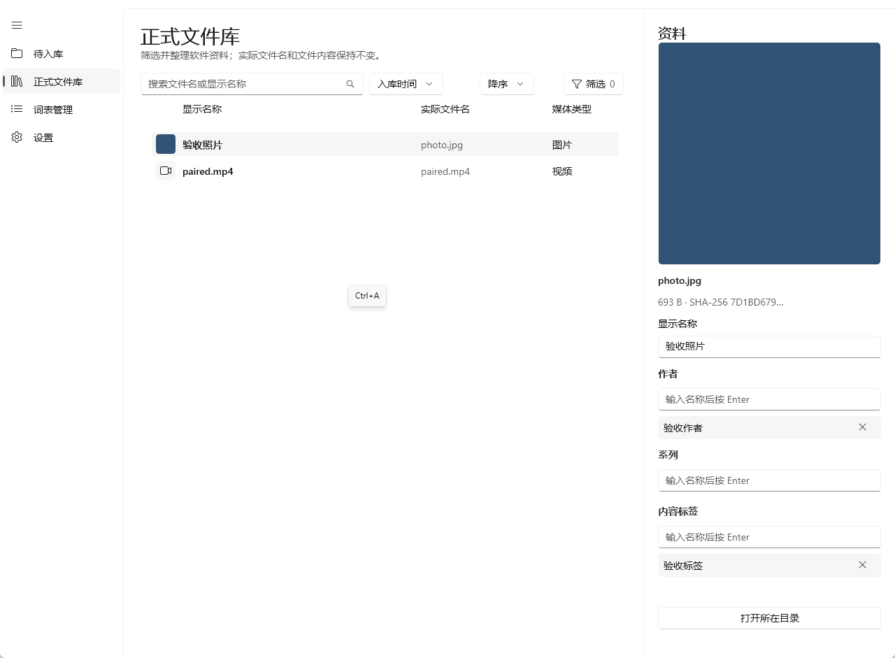

# TraceFold

TraceFold 是一个 Windows 桌面媒体整理工具：把待整理的照片和视频预览、标注后收入正式文件库，通过显示名称、作者、系列和内容标签查找素材。同名 MP4 + M4A 可先合并视频与音轨，再确认入库。

**当前版本：[v4.0.0-stage5cc 预发布版](https://github.com/NNBNBYLKW/TraceFold/releases/tag/v4.0.0-stage5cc)**

**系统：Windows 11 24H2（build 26100）或更新版本，x64。**

## 下载与快速开始

**[下载 Windows x64 产品 ZIP（约 226 MB）](https://github.com/NNBNBYLKW/TraceFold/releases/download/v4.0.0-stage5cc/TraceFold-MediaDesktop-Stage5C-C-win-x64.zip)**

1. 完整解压 ZIP，在解压后的文件夹中运行 **TraceFold.Media.exe**。保留同目录的文件与子目录，不要在 ZIP 内直接运行。
2. 打开 **设置 → 文件夹与扫描**，选择三个互不包含的目录：待入库目录、正式文件库目录和工作目录，点击 **保存设置**。
3. 先把少量照片或视频的**副本**放进待入库目录，回到 **待入库 → 立即刷新**。
4. 选中素材，查看预览并填写资料；如提示“需要前置处理”，先完成处理，再点击 **正式入库**。
5. 到 **正式文件库** 查看结果、搜索或按作者与标签筛选。

**入库成功后会按策略清理待入库源文件；配对处理的源文件也在成功入库后清理。首次使用请保留独立备份。** 完整步骤见 [使用指南](docs/getting-started.md)。

产品包包含 .NET、Windows App SDK 运行组件及 FFmpeg，通常无需另装。遇到问题请查看 [常见问题与排障](docs/troubleshooting.md)。

*预发布实测界面，使用示例素材。*

## 可以做什么

- 预览照片、普通视频，或处理同名 MP4/M4A 配对素材。
- 添加作者、系列和内容标签，正式入库后继续编辑资料。
- 搜索文件名或显示名称，结合词表筛选，查看词条与素材的引用关系。
- 遇到同名或内容冲突时比较新旧文件，再决定跳过、保留两者或替换选定目标。
- 软件中的显示名称与物理文件名分开；编辑显示名称不会重命名正式文件。

## 文档与反馈

- [使用指南](docs/getting-started.md)：目录设置、扫描、处理、入库和资料管理。
- [常见问题与排障](docs/troubleshooting.md)。
- [获取支持与报告问题](SUPPORT.md)。
- [文档导航](docs/README.md)。

## 开发与维护

开发者从 [开发文档](docs/development/README.md) 开始，按 [源码起步](docs/development/getting-started.md) 准备环境、构建和启动。

## 版本状态

当前为预发布版本，已有核心操作的实测记录。完整视觉矩阵与干净虚拟机验证尚未完成，兼容性仍需在实际机器上确认。已验证范围及已知限制见 [发布验收摘要](https://github.com/NNBNBYLKW/TraceFold/releases/download/v4.0.0-stage5cc/ACCEPTANCE-SUMMARY.zh-CN.md)。

## 其他下载项

| 下载项 | 用途 |
| --- | --- |
| TraceFold-MediaDesktop-Stage5C-C-win-x64.zip | 普通用户使用的产品包，包含桌面程序。 |
| TraceFold-MediaDesktop-Stage5C-C-UiAcceptance-win-x64.zip | UI 验收工具包（K），供开发与验证使用；普通使用不需要下载它。 |
| GitHub 自动提供的 Source code（zip / tar.gz） | 源码快照，不是已编译应用，不等同于产品 ZIP。 |

当前仓库未提供项目许可证文件；不要把随包第三方组件的许可证当作 TraceFold 项目的授权声明。第三方组件声明请参见发布包内相应说明。
